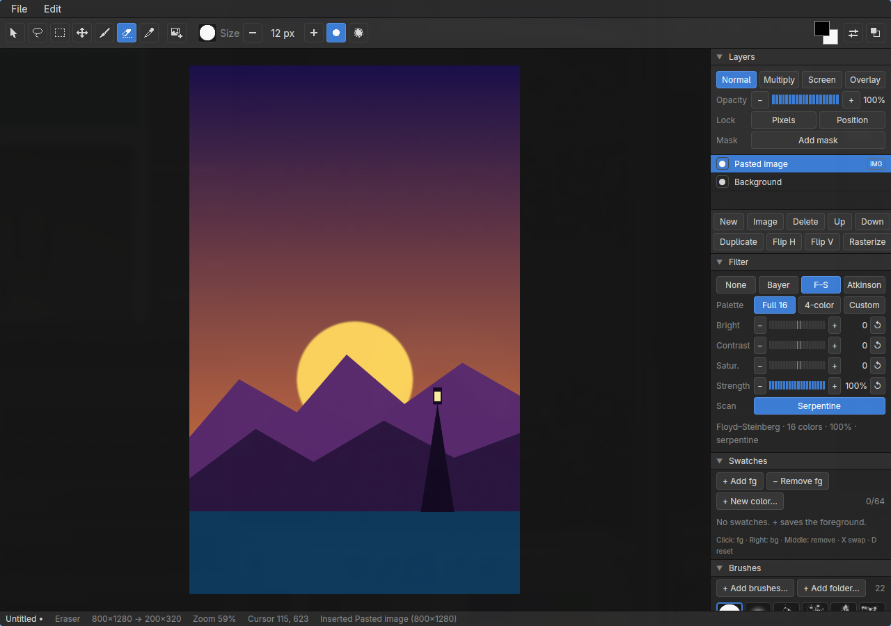
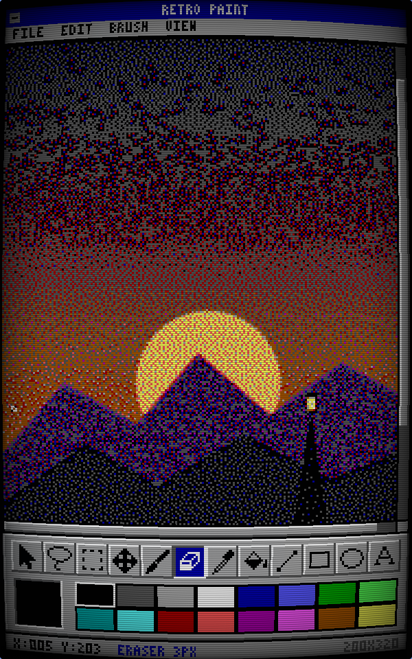

# retro-paint

retro-paint is a photobashing editor for making DOS-style pictures. You build an image at full color and full resolution, and a second window shows it live as a little DOS CGA paint program would: downscaled, dithered to the 16-color CGA palette (or a 4-color mode), and drawn through a CRT shader.

The DOS window is meant to be captured with OBS, mostly in a vertical 9:16 layout for short-form video, so the picture looks as if it were being painted on an old DOS machine.

- **Editor window** (`retro-paint-editor`, GPUI): the real UI. Layers, image insertion, brushes, move and transform, the dither filter panel, swatches, project settings.
- **DOS window** (`retro-paint-dos`, raylib): a display-only twin with a Deluxe Paint-style tool strip, a CGA palette strip, a canvas window that scrolls to follow your cursor, and a retro cursor. It never takes input.

Every pixel of the dithered output, in the DOS view and in exported PNGs, is one of the active palette's colors.

## Screenshots

The same picture in both windows: the full-color editor, and the DOS view's mobile layout (200×320, Floyd–Steinberg to the 16 CGA colors, through the CRT shader).

<p>
  
  
</p>

## Build and run

Linux only for v1 (developed on Arch with Hyprland on Wayland).

System packages (Arch names):

```bash
sudo pacman -S --needed cmake clang wayland libxkbcommon vulkan-icd-loader mesa
```

raylib builds its bundled C source (with GLFW's Wayland backend), and GPUI renders with Vulkan. Rust comes from `rust-toolchain.toml` via rustup.

```bash
cargo run --release -p retro-paint
```

Both windows open from one process. Quitting the editor (Ctrl+Q or closing its window) closes the DOS window too; closing the DOS window first only ends the view.

Debug builds (`cargo run -p retro-paint`) also work. The workspace builds third-party crates (GPUI, raylib, image codecs, and so on) with optimizations even in the dev profile, so a debug build starts and paints at a usable speed.

## Hyprland setup

[contrib/hyprland.conf](contrib/hyprland.conf) has window rules that put the editor on the left monitor and the DOS view full-size on a vertical right monitor, with opacity, blur, dimming, borders and rounding turned off so captured pixels stay exact. Set your monitor names at the top of the file, then source it from `~/.config/hypr/hyprland.conf`. See [contrib/README.md](contrib/README.md) for the steps, the desktop (16:9) variant, single-monitor use and OBS capture.

## Keyboard shortcuts

All shortcuts go to the editor window.

| Keys | Action |
|---|---|
| Ctrl+N | New document (800×1280 canvas, mobile layout, output ÷ 4) |
| Ctrl+O | Open a `.rpaint` project |
| Ctrl+I | Insert image(s) as new layers |
| Ctrl+V | Paste an image (or copied image files) as new layers |
| Ctrl+J | Duplicate the selected layer |
| Ctrl+S / Ctrl+Shift+S | Save / Save As |
| Ctrl+E | Export PNG |
| Ctrl+Shift+P | Project Settings |
| Ctrl+Q | Quit (asks first if there are unsaved changes) |
| Ctrl+Z | Undo |
| Ctrl+Shift+Z or Ctrl+Y | Redo |
| Ctrl+= (also Ctrl++ and Ctrl+Shift+=) / Ctrl+- | Zoom in / out |
| Ctrl+1 | Zoom to 100% |
| Ctrl+0 | Fit the canvas to the window |
| Ctrl+wheel | Zoom about the cursor |
| Wheel | Scroll the canvas |
| Space+drag, middle-drag | Pan |
| `S` / `L` / `R` / `M` / `B` / `E` / `I` | Select / Lasso / Rect Select / Move / Brush / Eraser / Picker tool |
| Ctrl+A / Ctrl+D | Select all / Deselect |
| Ctrl+Shift+I | Invert the selection (Edit > Invert Selection) |
| Escape (on the canvas) | One step back: drop an unfinished outline, else cancel a transform (selection kept), else deselect |
| Delete or Backspace | Erase the selected pixels of the selected layer (Edit > Clear) |
| Ctrl+T | Transform the selection (Edit > Transform Selection): drag inside to move, corners scale, the knob rotates |
| Enter / Escape (transforming a selection) | Apply / cancel the transform |
| Shift / Alt at the start of a selection | Add to / subtract from the selection |
| Shift during a Rect Select drag | Square the rectangle |
| Enter / Escape (Lasso) | Close / cancel the outline being drawn |
| `[` / `]` | Brush size down / up (round brushes 1–256 px, library brushes 1–1024 px) |
| `X` | Swap foreground and background colors |
| `D` | Reset colors to black on white |
| Arrows / Shift+arrows | Nudge the selected layer 1 px / 10 px (Move or Select tool) |
| Shift while scaling | Scale freely instead of keeping the aspect ratio |
| Shift while rotating | Snap to 15° steps |
| Enter / Escape | Apply / cancel a layer rename, Project Settings, the Export dialog or the color picker |
| Tab | Color picker: next field (Hex → R → G → B) |
| Enter / D / Escape | Save / Don't Save / Cancel in the unsaved-changes prompt |
| ←/→ or −/+, 1–8, F | Export dialog: scale down/up, set the scale, toggle the full-color file |

`[`, `]`, `X`, `D` and the tool letters work only with no Ctrl or Alt held (`X`, `D` and the tool letters also not with Shift), and never while typing a layer name or inside a dialog. Undo and redo do nothing while a dialog is open.

Mouse: with Brush, the left button paints the foreground color and the right button the background color. With Picker, left sets the foreground and right the background. With Rect Select, drag a rectangle. With Lasso, drag a freehand outline (it closes when you let go), or click to place straight segments (drags between clicks add freehand pieces) and finish with a double-click, Enter or a click on the first point. Click the foreground or background chip at the ribbon's right end to open the color picker for it; Swatches' **+ New color…** opens it to make a new swatch. In Swatches, click sets the foreground, right-click the background, middle-click removes the swatch. In Brushes, click a thumbnail to paint with that brush; **+ Add brushes…** and **+ Add folder…** load GIMP `.gbr`/`.vbr`/`.gih` and Photoshop `.abr` brushes (or drop files and folders on the section), and the added paths are remembered in `~/.config/retro-paint/brushes.json`. Double-click a layer to rename it. The ribbon's buttons are icons; hover one to see its name and shortcut.

## Files

- **Project: `.rpaint`.** A zip archive with `manifest.json` (a versioned manifest of project settings, the layer stack and the dither settings), one lossless PNG per paint layer and mask, and every inserted image at its original resolution under `sources/<sha256>.png`. Reopening a project gives byte-identical CGA output. Older versions are migrated on load; files from a newer retro-paint are refused. See [docs/file-format.md](docs/file-format.md).
- **Export: PNG.** The dithered output at the project's output resolution, optionally upscaled 1× to 8× with nearest neighbor, written as a 4-bit indexed PNG that can only contain palette colors. Optionally also the flattened full-color canvas as `<name>-full.png`. Export runs the same render as the live view.

## Three sizes

- **Canvas:** the full-color image you edit, any size.
- **Output:** the dithered image (for example canvas ÷ 4). The dither runs at this size, PNG export uses it, and the DOS canvas window shows it 1:1.
- **DOS screen:** fixed at 200×320 (mobile) or 320×200 (desktop).

All three are set in Project Settings.

## Development

The design docs in [docs/](docs/) are the spec.

```bash
scripts/check.sh            # the merge gate: fmt, clippy -D warnings, all tests
cargo test -p <crate>       # one crate
```

`crates/retro-paint/tests/end_to_end.rs` runs the whole pipeline headlessly: render, compose the DOS screen, export, save, reload and re-render, checking that everything comes back identical.
